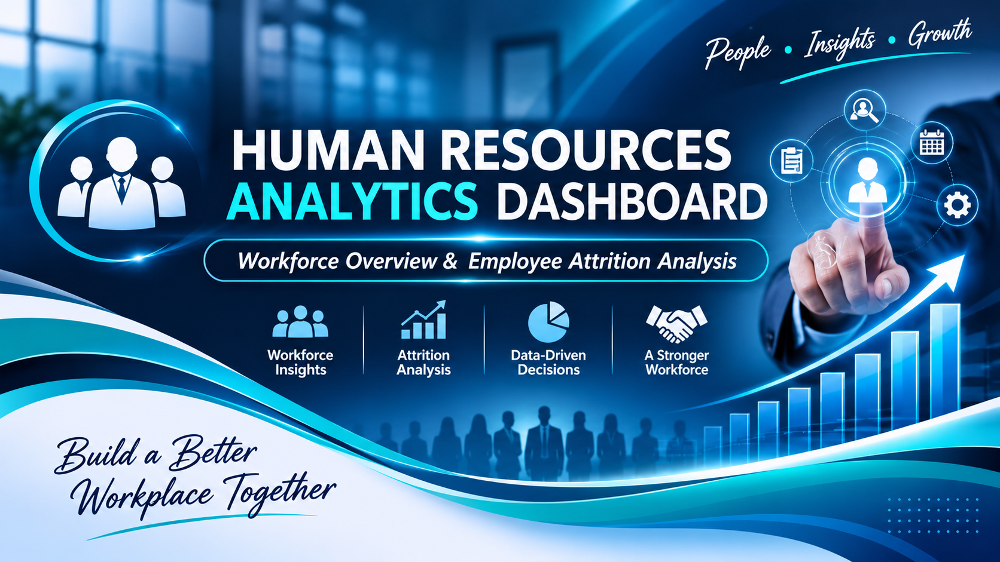

  

# HR Analytics Dashboard – Employee Attrition Analysis
An end-to-end HR analytics project built entirely in Excel. It takes a raw dataset of 1,470 employees and 35 attributes through data cleaning, validation, feature engineering, pivot analysis and financial analysis, and ends with an interactive dashboard on why employees leave and what it costs.

## Dashboard Preview
HR Analytics Dashboard - Excel

## Presentation
A 7-slide presentation summarising the problem, approach, KPIs, key findings and recommendations is included in this repository: HR_Analytics_Dashboard_Presentation.pptx.

## Business Problem
HR leadership wants to understand employee attrition:

How many people are leaving, and is the rate a concern?
Which departments, age groups, experience levels and salary bands are most affected?
How does pay relate to leaving, and what does each department cost?

## bHeadline KPIs
KPI	                     Value
Total Employees	         1,470
Active Employees	       1,233
Employees Left	         237
Attrition Rate	         16.12%
Average Monthly Salary	 6,502.93

## Key Insights

Early-career and low-tenure staff leave the most. Attrition is about 36% for ages 18-25 and about 44% for people with 0-2 years of total experience.
It falls steadily with age and experience.
Sales has the highest attrition rate (about 21%), followed by Human Resources (about 19%). Research & Development has the lowest rate (about 14%) but the largest number of leavers (133 of 237, 56%) because it is the biggest department.
Pay matters. Leavers earned about 4,787 per month on average, against about 6,833 for those who stayed. The Low salary band loses the highest share of its people.
Overtime is a strong signal. Attrition is about 30% for employees working overtime, against about 10% for those who do not.
Frequent travel and being single also show higher attrition (about 25% for both groups).

Percentages are calculated from the HR_Data sheet.

## Project Structure
Sheet	                  Purpose
HR_Data	                Original raw dataset (1,470 rows x 35 columns)
Cleaned_Data	          Cleaned data as an Excel Table (tblHR) with engineered columns
HR_Analysis	            Data quality report, validation checks and core business KPIs
Pivot_Analysis	        Pivot tables and charts for attrition by department, age, salary and experience
HR_Dashboard	          Final dashboard: KPI cards plus attrition and salary charts
Lookup_Practice	        XLOOKUP, VLOOKUP and INDEX/MATCH demonstrations
HR_Financial_Analysis	  Department salary cost, salary variance vs company average, management summary

## Tools & Technologies

- Microsoft Excel 365
- Excel Tables
- Excel Formulas and Functions
- PivotTables
- PivotCharts
- Data Cleaning and Validation
- Data Visualization

## Dataset Information

**Dataset:** IBM HR Analytics Employee Attrition & Performance

The dataset contains employee-related information, including:

- Employee demographics
- Department and job role
- Monthly income
- Job satisfaction
- Business travel
- Years of experience
- Years at company
- Attrition status

| Dataset Attribute | Details |
|---|---|
| Total Employees | 1,470 |
| Original Columns | 35 |
| Data Type | Structured HR Data |
| Target Variable | Attrition |

## Project Workflow

### 1. Data Preparation

- Imported the HR dataset into Excel.
- Created separate worksheets for raw data, cleaned data, analysis, PivotTables, and the dashboard.
- Created an Excel Table named `tblHR`.
- Prepared the dataset for further analysis.

### 2. Data Cleaning and Quality Checks

Performed data quality checks to assess the reliability of the dataset.

- Checked missing values.
- Checked duplicate employee IDs.
- Validated categorical fields.
- Checked numerical value ranges.
- Inspected filters and data consistency.

### 3. Feature Engineering

Created four additional calculated columns to support workforce analysis.

| Calculated Column | Description |
|---|---|
| AgeGroup | Groups employees into age categories |
| SalaryBand | Categorises employees according to monthly income |
| ExperienceCategory | Groups employees based on total working experience |
| TenureCategory | Groups employees according to years at the company |

### 4. HR Business Analysis

Developed workforce KPIs and performed employee analysis using Excel formulas.

**Workforce KPIs:**
- Total Employees
- Active Employees
- Employees Left
- Attrition Rate
- Average Monthly Salary
- Average Employee Age
- Average Years at Company

**Additional Analysis:**
- Department-wise employee attrition
- Gender distribution and attrition
- Job satisfaction distribution

### 5. PivotTable Analysis

Created PivotTables to explore employee attrition patterns across:

- Departments
- Age groups
- Salary bands
- Experience categories

### 6. PivotCharts and Dashboard Development

Developed PivotCharts to communicate workforce trends and attrition patterns.

The HR Dashboard is being designed with:

- KPI cards
- Department-wise attrition charts
- Age group analysis
- Salary band analysis
- Experience-based attrition analysis
- Gender distribution
- Job satisfaction analysis

## Key Workforce Metrics

The following are reference KPI results from the IBM HR Analytics dataset.

| KPI | Result |
|---|---:|
| Total Employees | 1,470 |
| Active Employees | 1,233 |
| Employees Left | 237 |
| Attrition Rate | 16.12% |
| Average Monthly Salary | 6,502.93 |
| Average Employee Age | 36.92 years |
| Average Years at Company | Approximately 7.01 years |

## Excel Workbook Structure

The workbook contains five worksheets:

| Worksheet | Purpose |
|---|---|
| HR_Data | Original employee dataset |
| Cleaned_Data | Prepared dataset and calculated columns |
| HR_Analysis | Data quality checks, KPIs, and business analysis |
| Pivot_Analysis | PivotTables and PivotCharts |
| HR_Dashboard | Final HR dashboard and visualisations |

## Skills Demonstrated

- Data Cleaning
- Data Validation
- Data Quality Analysis
- Excel Formulas and Functions
- Feature Engineering
- HR Analytics
- Workforce Analysis
- Employee Attrition Analysis
- PivotTable Analysis
- Data Visualization
- Dashboard Development
- Business Insight Generation

## Future Improvements

- Complete the final dashboard design.
- Add interactive filters and slicers where supported.
- Improve dashboard formatting and visual consistency.
- Develop additional HR insights and recommendations.
- Complete final dashboard validation.

## Project Status

**In Progress – Dashboard Development**

## Author

**Hiruni Siyambalapitiya**

BSc (Hons) in Information Technology – SLIIT

GitHub: [hiruni-siyambalapitiya](https://github.com/hiruni-siyambalapitiya)
